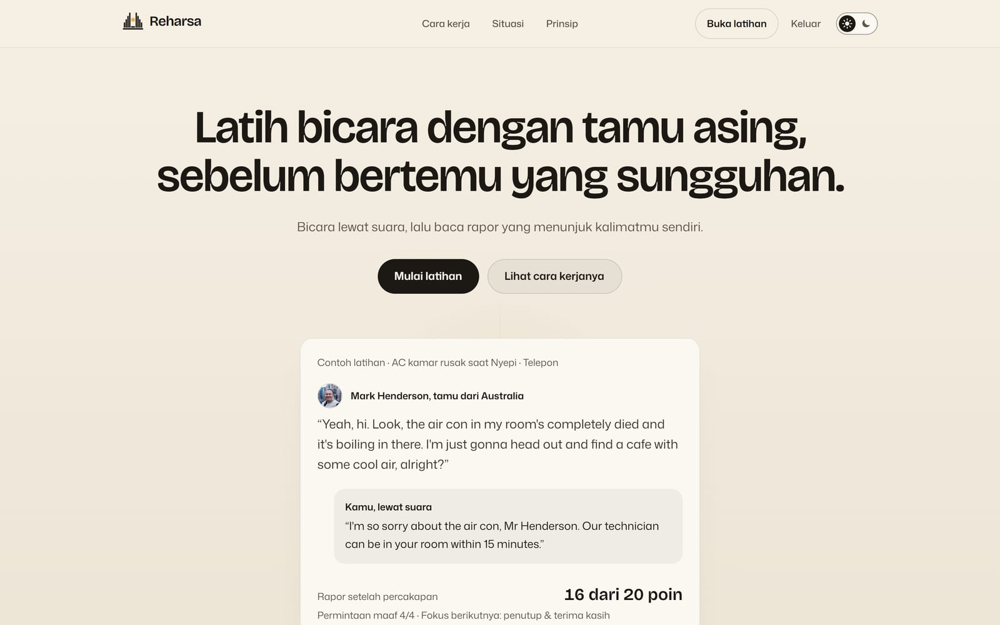
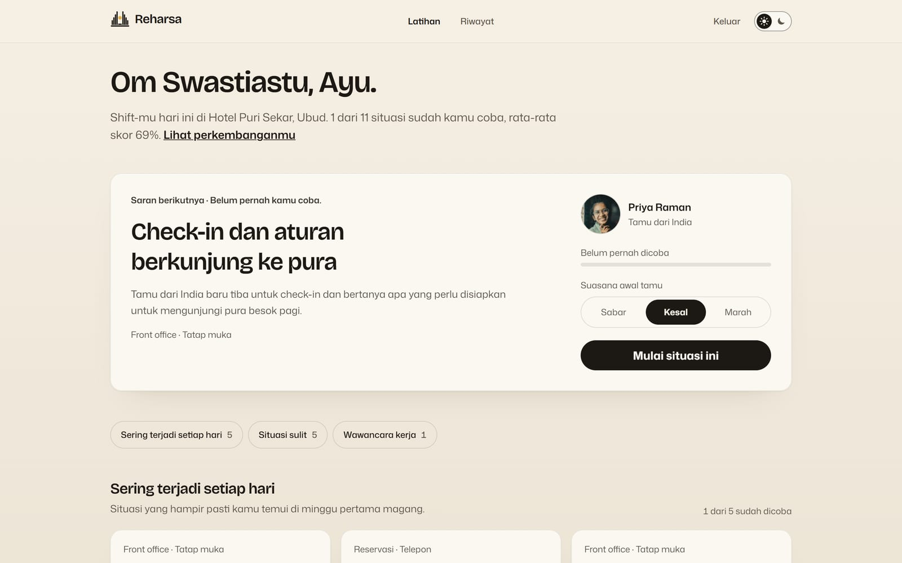
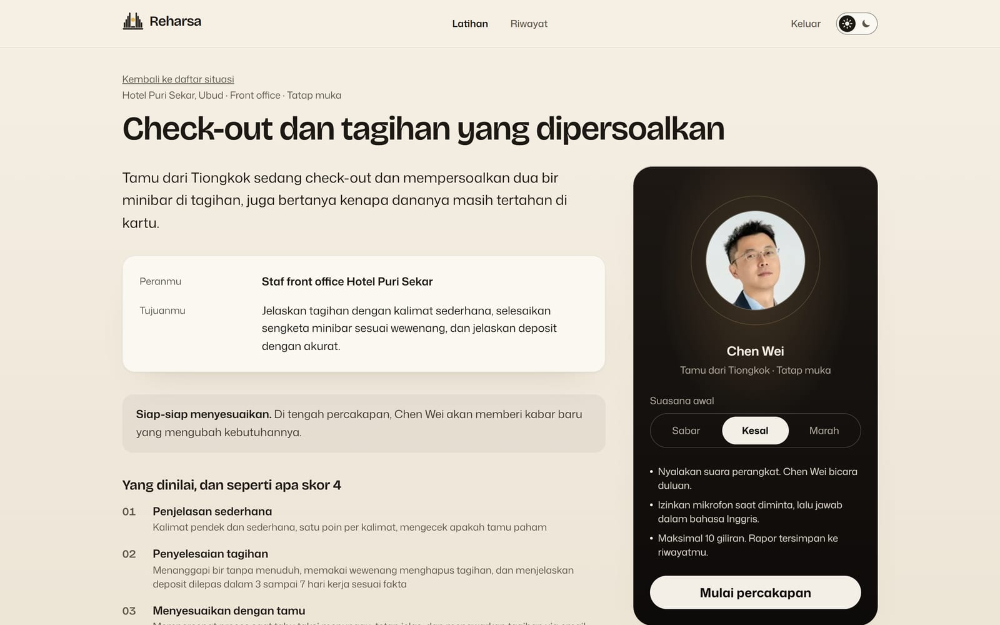
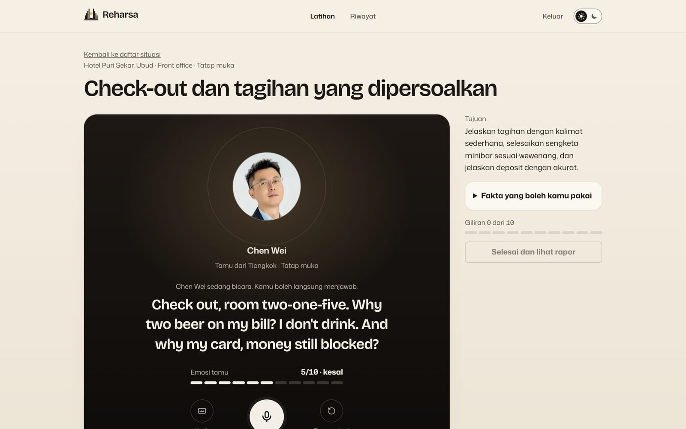
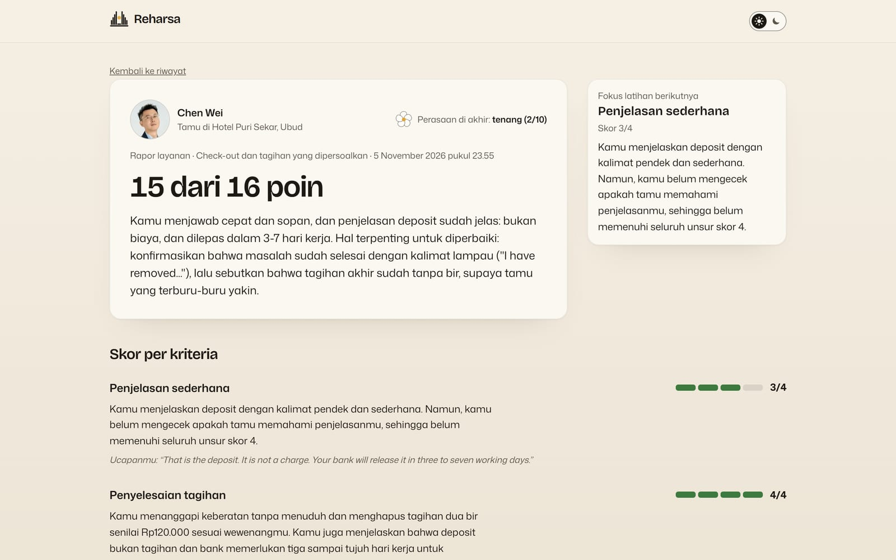
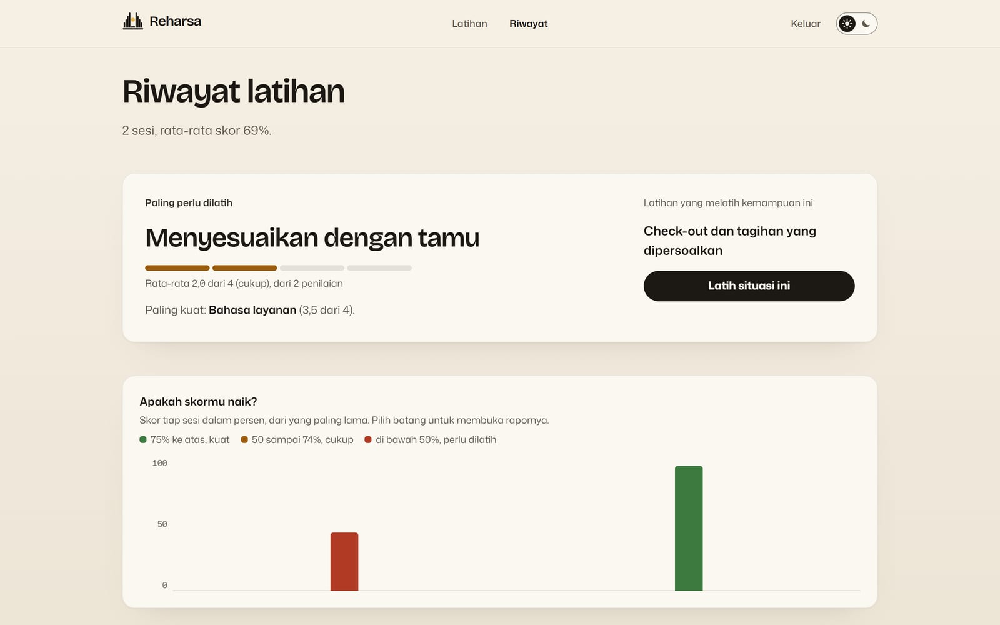
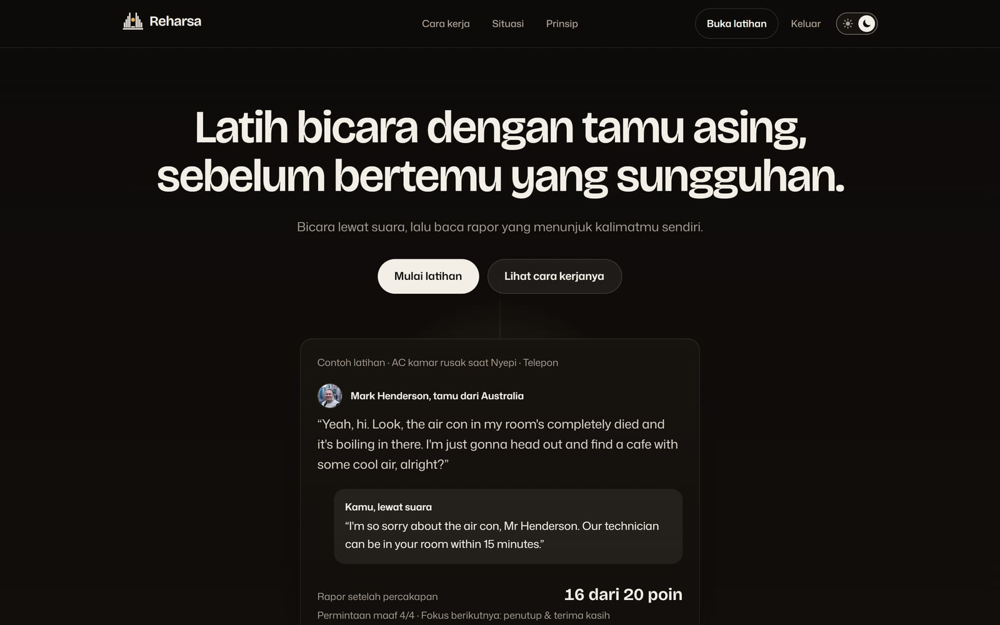
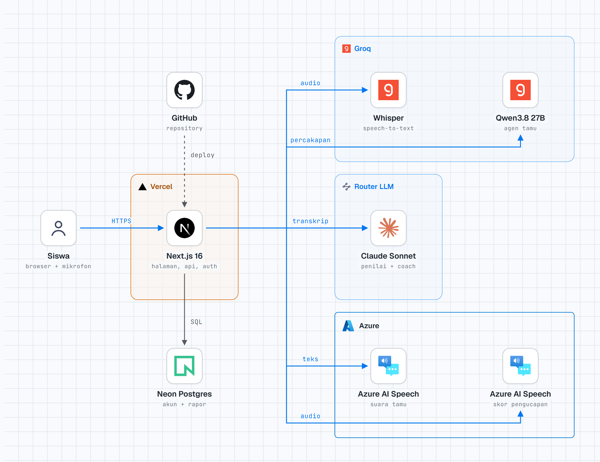

<div align="center">
  <picture>
    <source media="(prefers-color-scheme: dark)" srcset="public/brand/reharsa-mark-cream.svg">
    
  </picture>
  <br><br>
  <h1>Reharsa</h1>
  <p><strong>Latih bicara dengan tamu asing, sebelum bertemu yang sungguhan. Siswa pariwisata melayani tamu hotel AI lewat suara, lalu membaca rapor yang menunjuk kalimatnya sendiri.</strong></p>
  <p>
    <a href="https://reharsa.web.id"><strong>Live App</strong></a>
    &nbsp;|&nbsp;
    <a href="src/lib/server/agents.ts"><strong>Kode AI</strong></a>
    &nbsp;|&nbsp;
    <a href="#ai--technology-disclosure"><strong>AI &amp; Technology Disclosure</strong></a>
  </p>
  <p>
    <a href="https://nextjs.org/"></a>
    <a href="https://react.dev/"></a>
    <a href="https://www.typescriptlang.org/"></a>
    <a href="https://tailwindcss.com/"></a>
    <a href="https://neon.tech/"></a>
    <a href="https://www.better-auth.com/"></a>
    <a href="https://groq.com/"></a>
    <a href="https://azure.microsoft.com/products/ai-services/ai-speech"></a>
  </p>
</div>



| Suara dua arah yang beraksen | Penilai terpisah dari tamu | Tamu yang berpijak pada fakta | Tetap jalan saat layanan gagal |
|---|---|---|---|
| Siswa menjawab lewat mikrofon. Sebelas tamu dari tujuh negara membalas dengan suara [Azure Neural](src/lib/server/speech.ts) beraksen, dan tempo serta nada suaranya mengikuti emosi tamu. | [Agen tamu](src/lib/server/agents.ts) hanya bermain peran. Skor 0 sampai 4 per kriteria dibuat agen penilai lain sesudah percakapan, dengan kutipan ucapan siswa sebagai bukti. | Tamu hanya memakai lembar fakta [skenario](src/lib/scenarios.ts): harga, aturan, dan batas wewenang staf. Ia tidak mengarang layanan yang tidak ada. | [Rantai provider LLM](src/lib/server/llm.ts) melewati provider yang kena batas atau gagal. Ada cadangan suara browser dan mode ketik. URL dan model tidak ditanam di kode. |

Karya untuk **AI Web Innovation Challenge Bali DigiFest 2026**, kategori Mahasiswa/Umum, subtema Education & Smart Information Systems. Aplikasi berjalan di **https://reharsa.web.id**; versi yang dinilai pada Tahap 1 adalah tag `v1.0-submission`.

## 1. Description

Reharsa adalah simulator tamu hotel berbasis AI untuk siswa dan mahasiswa pariwisata. Siswa melayani tamu yang punya nama, asal, aksen, dan suasana hati di hotel fiktif Hotel Puri Sekar, Ubud, dengan bicara dalam bahasa Inggris. Satu sesi berjalan seperti panggilan: tamu bicara lebih dulu, siswa menjawab lewat mikrofon, dan tamu menanggapi sesuai fakta hotel dan emosinya. Di tengah percakapan tamu bisa memberi kabar baru yang memaksa siswa menyesuaikan solusi.

Setelah selesai, rapor menunjukkan skor tiap kriteria, kalimat siswa yang menjadi buktinya, dan contoh kalimat yang lebih baik. Setiap rapor tersimpan di akun siswa, sehingga perkembangan antar sesi bisa dilihat.

## 2. Problem

Kemampuan melayani tamu asing dalam bahasa Inggris menentukan kelulusan magang, uji kompetensi, dan wawancara kerja di hotel atau kapal pesiar. Di kelas, latihannya biasanya role-play antarteman:

- **Lawan bicaranya tidak terasa nyata:** aksennya sama, dan teman tahu itu hanya latihan.
- **Skenarionya tidak berubah** di tengah jalan, padahal tamu sungguhan sering membawa kabar baru.
- **Umpan baliknya tipis:** satu guru tidak sempat menilai rinci setiap pasangan, dan catatan lisan di akhir kelas mudah terlupa sebelum latihan berikutnya.
- **Kesempatan berlatih sedikit:** siswa jarang bisa bicara dengan tamu asing sungguhan sebelum magang.

## 3. Target User

Siswa SMK pariwisata dan perhotelan serta mahasiswa D3/D4 pariwisata, khususnya di Bali. Kebutuhan mereka:

- **Lawan bicara yang terasa nyata:** aksen dan karakter tamu yang berbeda, bukan suara teman sekelas.
- **Situasi yang benar-benar terjadi:** dari reservasi lewat telepon sampai tamu yang terjebak abu vulkanik.
- **Umpan balik yang spesifik:** kalimat mana yang tepat, mana yang perlu diperbaiki, dan contoh penggantinya.
- **Latihan berulang tanpa malu:** bisa diulang kapan saja, dengan suasana awal tamu yang bisa dipilih.

## 4. Key Features

**Fitur inti (sudah berfungsi):**

- **Percakapan suara dua arah:** rekaman mikrofon diubah menjadi teks, tamu AI menjawab dengan suara beraksen. Teks berjalan tampil selama siswa bicara.
- **11 situasi dalam tiga kategori:** lima situasi sehari-hari (check-in dan aturan pura, reservasi telepon, check-out dengan tagihan dipersoalkan, info wisata dan transportasi, kamar belum dibersihkan), lima situasi sulit (AC rusak saat Nyepi, alergi kacang, overbooking, penerbangan batal karena abu vulkanik, tamu sakit tengah malam), dan satu wawancara kru kapal pesiar.
- **Tamu dengan emosi dan kejutan:** suasana awal sabar, kesal, atau marah; emosi 0 sampai 10 berubah tiap giliran beserta alasannya; kabar baru di tengah percakapan.
- **Rapor berbasis rubrik:** skor 0 sampai 4 per kriteria, kutipan ucapan siswa, tingkat keyakinan penilai, ringkasan, dan contoh kalimat yang lebih baik dalam bahasa Indonesia.
- **Skor kejelasan pengucapan per kata** untuk jawaban yang diucapkan lewat mikrofon.
- **Akun siswa dan riwayat:** semua rapor tersimpan, grafik skor per sesi, rata-rata per kemampuan, kemampuan yang paling perlu dilatih, dan saran situasi berikutnya.

**Fitur tambahan:**

- Mode ketik bila mikrofon atau layanan suara tidak tersedia.
- Tema terang (bawaan) dan gelap, serta aksesibilitas dasar (kontras AA, navigasi papan ketik, mode kurangi gerak).

### Product tour

| Pilih situasi | Brief sebelum mulai |
|---|---|
|  |  |
| Saran situasi berikutnya, lalu kartu situasi per kategori dengan skor terbaikmu. | Peran, tujuan, peringatan kejutan, gambaran skor 4 tiap kriteria, dan tamu yang akan kamu layani. |
| **Panggung suara** | **Rapor** |
|  |  |
| Tamu di tengah, kalimatnya dalam ukuran besar, meter emosi, dan tombol bicara. Cincin di sekitar foto mengikuti suara. | Perasaan tamu di akhir, total poin, ringkasan, fokus latihan berikutnya, dan skor per kriteria dengan kutipanmu. |
| **Riwayat** | **Tema gelap** |
|  |  |
| Kemampuan yang paling perlu dilatih, situasi untuk melatihnya, dan grafik skor tiap sesi. | Halaman depan dalam tema gelap; pilihan tema diingat untuk kunjungan berikutnya. |

## 5. Tech Stack

| Lapisan | Implementasi |
|---|---|
| Frontend | Next.js 16.4 (App Router, Cache Components), React 19.3, TypeScript, Tailwind CSS 4 |
| Backend | Next.js Route Handlers di Node.js, validasi Zod 4, Better Auth 1.7 (email dan password, sesi berbasis cookie) |
| Database | Postgres di Neon (tier gratis, region Singapura), driver `pg` |
| AI | Groq (Whisper, Qwen), Claude Sonnet lewat router kompatibel OpenAI, Azure AI Speech |
| Hosting | Vercel (region Singapura) dengan domain reharsa.web.id |

## 6. AI Implementation

AI adalah inti produk: tanpa AI tidak ada tamu yang bicara, menanggapi, dan menilai.

- **Model/API:** Groq `whisper-large-v3-turbo`, Groq `qwen/qwen3.8-27b`, Claude Sonnet lewat router kompatibel OpenAI, Azure AI Speech (Neural TTS dan Pronunciation Assessment).
- **AI function:** mengubah suara siswa menjadi teks, memerankan tamu yang beremosi, membacakan kalimat tamu dengan aksen, menilai kejelasan pengucapan, dan menilai percakapan dengan rubrik beserta umpan balik.
- **Input:** audio jawaban siswa, transkrip percakapan, persona dan fakta skenario, emosi tamu saat ini, rubrik penilaian.
- **Output:** kalimat dan emosi tamu, suara tamu, skor pengucapan per kata, rapor (skor 0 sampai 4 per kriteria, kutipan bukti, ringkasan, contoh kalimat yang lebih baik).

| Komponen | Model / layanan | Input → output | Kode |
|---|---|---|---|
| Speech-to-Text | Groq `whisper-large-v3-turbo`; cadangan: pengenalan suara browser | Audio WAV 16 kHz → teks jawaban siswa | [`speech.ts`](src/lib/server/speech.ts) |
| Agen Tamu | LLM berantai `GUEST_LLM_ORDER`: Groq `qwen/qwen3.8-27b`, lalu Claude Sonnet lewat router | Persona, fakta skenario, kejutan, riwayat percakapan, emosi saat ini → `{reply, emotion, emotion_reason, resolved}` | [`agents.ts`](src/lib/server/agents.ts) |
| Text-to-Speech | Azure Neural TTS (11 suara: en-AU, en-IN, en-GB, ko-KR, zh-CN, fr-FR, de-DE); cadangan: suara browser | Kalimat tamu + emosi → audio; tempo dan nada naik saat tamu marah | [`speech.ts`](src/lib/server/speech.ts) |
| Pronunciation Assessment | Azure AI Speech | Audio + teks acuan → akurasi, kelancaran, skor per kata | [`speech.ts`](src/lib/server/speech.ts) |
| Agen Penilai dan Coach | LLM berantai `JUDGE_LLM_ORDER`: Claude Sonnet lewat router, lalu Groq | Transkrip + rubrik → skor 0 sampai 4, kutipan bukti, keyakinan per kriteria; ringkasan dan contoh kalimat lebih baik | [`agents.ts`](src/lib/server/agents.ts) |

**Kenapa AI diperlukan.** Tamu harus menanggapi jawaban siswa yang tidak bisa diduga, berubah emosinya sesuai cara siswa bicara, dan tetap konsisten dengan fakta hotel. Skrip bercabang tidak bisa melakukan itu. Penilaian juga harus membaca makna kalimat, bukan mencocokkan kata kunci.

**Keputusan desain:**

- **Agen tamu dan agen penilai dipisah,** supaya skor tidak dipengaruhi jalannya role-play dan tamu tidak "membocorkan" penilaian.
- **Grounding:** tamu hanya boleh memakai fakta skenario, termasuk batas wewenang staf (misalnya hapus tagihan minibar sampai Rp200.000).
- **Output terstruktur:** semua balasan LLM berupa JSON yang divalidasi Zod. Yang tidak valid dicoba ulang sekali, lalu pindah ke provider berikutnya.
- **Adil terhadap aksen:** penilai menilai kejelasan dan kesopanan, bukan kemiripan dengan penutur asli. Skor pengucapan ditampilkan terpisah dan tidak dihitung ke poin rapor.
- **Penanda markdown dibersihkan** dari kalimat tamu sebelum tampil dan dibacakan.

**Penanganan gagal:** provider yang membalas 429 atau 5xx dilewati sementara (mengikuti `retry-after`, bawaan 60 detik) dan permintaan pindah ke provider berikutnya. Transkripsi gagal → teks dari pengenalan suara browser. Suara Azure tidak tersedia → suara browser. Mikrofon ditolak → pesan jelas dan mode ketik. Semua gagal → pesan dalam bahasa awam dan tombol "Kirim ulang"; detail teknis hanya di log server.

**Data yang dikirim ke model:** teks percakapan latihan dan audio jawaban untuk transkripsi serta penilaian pengucapan. Rekaman suara tidak disimpan. Nama akun siswa tidak dikirim ke layanan AI.

## 7. Architecture

<picture>
  <source media="(prefers-color-scheme: dark)" srcset="docs/readme/arsitektur-gelap.png">
  
</picture>

Agen tamu dan agen penilai memakai rantai LLM: bila provider utama gagal atau kena batas, permintaan pindah ke provider berikutnya (agen tamu: Groq lalu router; penilai: router lalu Groq).

```text
Per giliran
  Browser   rekam suara, ubah ke WAV 16 kHz, tampilkan teks berjalan
  /api/stt  audio → teks jawaban
  /api/guest  teks + riwayat + emosi → kalimat tamu + emosi baru
  /api/tts  kalimat tamu + emosi → suara beraksen
  /api/pronunciation  audio + teks → skor kejelasan per kata (berjalan di latar)

Akhir sesi
  /api/evaluate  transkrip → Agen Penilai dan Agen Coach (paralel) → rapor → tersimpan ke akun
```

Semua route AI menolak permintaan tanpa sesi login, jadi kuota layanan tidak bisa dipakai pengunjung anonim. Database hanya menyimpan akun dan rapor (tabel `practice_session`: transkrip, skor, umpan balik, skor pengucapan). Setiap kueri riwayat difilter dengan `user_id`, sehingga siswa hanya bisa membuka rapornya sendiri ([`history.ts`](src/lib/server/history.ts)).

**Struktur repository:**

```text
src/app/           halaman (depan, latihan, riwayat, masuk, daftar) dan Route Handlers di api/
src/components/    panggung suara, rapor, grafik riwayat, logo, saklar tema
src/lib/           skenario dan rubrik, perhitungan progres, foto tamu
src/lib/server/    agen AI, rantai LLM, layanan suara, akun, riwayat, batas pemakaian
scripts/           migrasi database dan pengisian akun demo
public/            foto tamu, foto tempat, file merek
docs/readme/       tangkapan layar README
DESIGN.md          arah desain, token warna, dan keputusan pemilik
```

## 8. Installation / Local Run

Butuh Node.js 20 atau lebih baru dan database Postgres (misalnya Neon tier gratis).

```bash
npm install
cp .env.example .env.local     # isi nilai variabel (lihat bagian 9)
npm run db:migrate             # buat tabel akun dan practice_session
npm run dev                    # buka http://localhost:3000
```

| Perintah | Kegunaan |
|---|---|
| `npm run dev` | Server pengembangan |
| `npm run build` lalu `npm start` | Build dan jalankan versi produksi |
| `npm run lint` | ESLint |
| `npx tsc --noEmit` | Pemeriksaan tipe TypeScript |
| `npm run db:migrate` | Membuat tabel Better Auth dan `practice_session` |
| `npm run demo:seed` | Mengisi akun demo dengan sesi latihan sungguhan lewat API (dev server harus berjalan, atau isi `DEMO_BASE_URL`) |

Belum ada rangkaian tes otomatis. Sebelum setiap commit, lint, pemeriksaan tipe, dan production build dijalankan, lalu alur utama dicoba di browser.

## 9. Environment Variables

Nama variabel ada di [`.env.example`](.env.example), tanpa nilai. Nilai asli hanya disimpan di `.env.local` (diabaikan git) dan di pengaturan environment Vercel; tidak ada secret di repository. Kode tidak menyimpan URL, model, atau urutan provider; semuanya dibaca dari environment.

| Variabel | Fungsi |
|---|---|
| `GUEST_LLM_ORDER`, `JUDGE_LLM_ORDER` | Urutan provider per agen, nama dipisah koma |
| `{NAMA}_BASE_URL`, `{NAMA}_MODEL`, `{NAMA}_API_KEY` | Satu provider dengan endpoint kompatibel OpenAI; provider tanpa key dilewati |
| `{NAMA}_JSON_MODE=false` | Opsional, untuk provider yang menolak `response_format` |
| `STT_BASE_URL`, `STT_MODEL`, `STT_API_KEY` | Speech-to-Text (`/audio/transcriptions`) |
| `AZURE_SPEECH_REGION`, `AZURE_SPEECH_KEY` | Suara tamu dan skor pengucapan |
| `DATABASE_URL` | Koneksi Postgres |
| `BETTER_AUTH_SECRET`, `BETTER_AUTH_URL` | Kunci sesi login dan alamat aplikasi |
| `DEMO_EMAIL`, `DEMO_PASSWORD`, `DEMO_BASE_URL` | Hanya untuk `npm run demo:seed` di komputer tim; tidak dipakai aplikasi |

Menambah provider, misalnya OpenRouter: isi `OPENROUTER_BASE_URL`, `OPENROUTER_MODEL`, `OPENROUTER_API_KEY`, lalu tambahkan `OPENROUTER` ke urutan agen.

## 10. Deployment

**URL:** https://reharsa.web.id

- **Platform:** Vercel (region Singapura), database Neon Postgres (region Singapura).
- **Versi yang dinilai:** tag `v1.0-submission` (Tahap 1).
- **Akun:** latihan memerlukan akun. Juri bisa membuat akun sendiri di halaman **Daftar**, atau memakai akun demo khusus juri yang sudah berisi riwayat latihan (balasan tamu dan skor dibuat AI; jawaban siswa ditulis tim dengan kualitas bertahap). **Kredensial akun demo dikirim lewat form panitia, tidak dicantumkan di repository.**
- **Kuota:** semua layanan AI memakai tier gratis. Tim memantau pemakaian selama masa penjurian (lihat bagian 13).

## 11. Team Members

| Nama | Peran |
|---|---|
| Komang Agus Wira Adnyana (ketua) | Pengembangan aplikasi, integrasi AI, dan deployment |
| I Made Megadhana | Desain antarmuka dan pengalaman pengguna |
| Agus Kimura Juniarta | Pengembangan aplikasi, deployment, dan dokumentasi |

## 12. Third-party Resources / Credits

- **Library:** Next.js, React, Tailwind CSS, Zod, Better Auth, node-postgres (lisensi MIT).
- **Model dan layanan AI:** Groq API (Whisper, Qwen), Claude Sonnet lewat router kompatibel OpenAI, Azure AI Speech.
- **Infrastruktur:** Neon Postgres, Vercel.
- **Dataset:** tidak ada. Skenario, fakta Hotel Puri Sekar, dan rubrik ditulis tim.
- **Font:** Bricolage Grotesque dan Mona Sans (SIL Open Font License).
- **Template:** tidak ada selain struktur proyek standar Next.js.
- **Foto tamu** dari Unsplash (Unsplash License), dipotong ke wajah. Orang di foto adalah model, bukan tokoh yang diperankan. Fotografer: Sophie Paterson, Nandu Vasudevan, Olga Zhuravleva, panitan punpuang, Let hho, Vicky Hladynets, Zoran Borojevic, Jake Nackos, Beatriz Cattel, Brooke Balentine, DICSON. Tautan tiap foto ada di [`src/lib/guest-photos.ts`](src/lib/guest-photos.ts).
- **Foto gerbang candi bentar di pantai** pada bagian penutup halaman depan: Galih Jelih, [Unsplash](https://unsplash.com/photos/NfbnXtCxoWI), Unsplash License.
- **Diagram arsitektur** dibuat dengan [stack-diagram](https://github.com/caru-ini/stack-diagram) (lisensi MIT). Logo di dalamnya dari svgl, devicon, Azure Public Service Icons, dan Lucide; semua logo adalah merek dagang pemiliknya.
- **Logo** Reharsa dibuat tim. Hotel Puri Sekar dan semua tokoh tamu adalah fiktif, dibuat untuk latihan.

## 13. Known Limitations

- **Kuota tier gratis** (Groq, Azure Speech F0, router LLM) bisa habis bila banyak pengguna berlatih bersamaan. Bila suara Azure habis, suara tamu memakai suara browser dan skor pengucapan tidak tersedia sementara.
- **Batas pemakaian per IP** disimpan di memori server, jadi di lingkungan serverless batasnya per instance.
- **Penilai kadang terlalu murah hati** untuk jawaban yang sopan tetapi kurang lengkap. Skrip evaluasi otomatis (golden set) belum dibuat.
- **Skor pengucapan** memakai acuan en-US dan hanya ditampilkan sebagai kejelasan kata.
- **Skor rapor adalah alat latihan, bukan sertifikasi.**
- Mikrofon dan suara paling andal di Chrome dan Edge. Belum ada reset password lewat email.

## AI & Technology Disclosure

| Komponen | Isi |
|---|---|
| Nama Produk | Reharsa |
| Framework / Frontend | Next.js 16.4 (App Router), React 19.3, TypeScript, Tailwind CSS 4 |
| Backend / Runtime | Next.js Route Handlers di Node.js, validasi Zod 4, Better Auth 1.7 |
| Database / Storage | Postgres di Neon, driver `pg`; rekaman suara tidak disimpan |
| Hosting / Deployment | Vercel (aplikasi, domain reharsa.web.id), Neon (database) |
| AI Model / API / Method | Groq `whisper-large-v3-turbo` (speech-to-text); Groq `qwen/qwen3.8-27b` dan Claude Sonnet lewat router kompatibel OpenAI (agen tamu, penilai, coach); Azure AI Speech Neural TTS dan Pronunciation Assessment |
| Peran AI dalam Produk | Memerankan tamu yang bicara dan beremosi, mengubah suara siswa menjadi teks, membacakan kalimat tamu dengan aksen, menilai transkrip dengan rubrik, memberi umpan balik dan contoh kalimat, menilai kejelasan pengucapan |
| Dataset / Data Source | Tidak memakai dataset eksternal. Skenario, fakta Hotel Puri Sekar (fiktif), dan rubrik ditulis tim. Tidak ada data pribadi nyata |
| Open-source Libraries | Next.js, React, Tailwind CSS, Zod, Better Auth, node-postgres, ESLint, TypeScript |
| Template / Boilerplate | Tidak memakai template atau boilerplate pihak ketiga selain struktur proyek standar Next.js |
| AI Coding Assistant | Claude Code (Anthropic) dipakai sebagai asisten pengembangan untuk menulis dan merapikan kode, menyusun draf skenario dan rubrik, merancang antarmuka, dan membantu pengujian. Setiap perubahan diarahkan, ditinjau, dan diuji tim |
| Existing before competition | Tidak ada. Tidak ada kode, desain, atau data yang dibuat sebelum kompetisi |
| Development for competition | Seluruh produk: kode, skenario, rubrik, desain, dan logo, dimulai dari commit pertama `956ea60` (5 November 2026) |
| Third-party Assets / Credits | Font Bricolage Grotesque dan Mona Sans (SIL Open Font License); foto tamu dan foto gerbang dari Unsplash (Unsplash License); lihat bagian 12 |

> Kami menyatakan bahwa informasi di atas benar dan lengkap. Kami bertanggung jawab atas penggunaan teknologi, source code, data, library, API, model AI, dan aset yang digunakan pada produk.
